# 从零开始使用 ICS 课程课件

本课程的课件放在 GitHub 上：<https://github.com/SJTU-IPADS/OS-Course-Lab>，其中 `ICS-PPT/` 目录是课件本身和把它渲染成幻灯片的工具 lecturekit。课件不是一份 `.pptx` 文件，而是一组 Python 源文件：你在自己的电脑上运行一条命令，它就在浏览器里打开成幻灯片，也可以导出成 PDF 或可编辑的 PowerPoint。

这份教程假定你没有安装过 Git 和 Python，也很少使用命令行。它按操作系统分成三部分，你只需要读自己电脑对应的那一部分，再读第四部分「使用课件」。

| 你的电脑 | 读哪一部分 |
| --- | --- |
| Windows 10 / 11 | [第一部分：Windows](#第一部分windows) |
| macOS | [第二部分：macOS](#第二部分macos) |
| Ubuntu Linux | [第三部分：Ubuntu](#第三部分ubuntu) |
| 装好之后 | [第四部分：使用课件](#第四部分使用课件)、[常见问题](#常见问题) |

## 总览：要做的四件事

无论哪种系统，步骤都一样，只是命令略有差别。

1. **安装三个工具。** Git 用来从 GitHub 下载课件并在之后更新，Python 运行 lecturekit 框架，Node.js 把幻灯片渲染成网页。
2. **下载课件。** 用 Git 把整个仓库复制到你的桌面上，之后一条命令就能同步老师的更新。
3. **安装 lecturekit。** 在课件目录里运行两条安装命令。
4. **打开一讲。** 运行一条命令，浏览器弹出课件的目录，点进任意一页。

仓库里和课件有关的只有 `ICS-PPT` 目录：`lecturekit` 是渲染工具，`lectures` 下每个子目录是一讲（`1-intro`、`2-data`、`3-asm`、……）。通过 Git 同步到本机后目录结构和 GitHub 上完全一样。

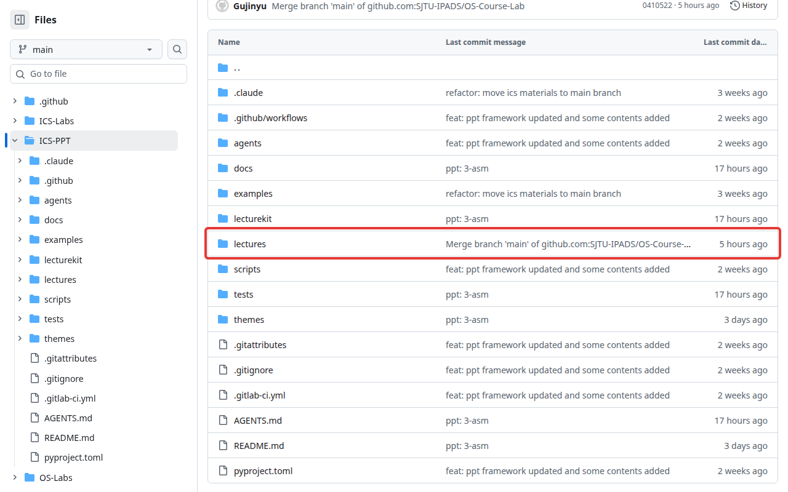

下面是最终效果：左图是课件的大纲，右图是其中一页。

| 大纲 | 一页幻灯片 |
| --- | --- |
| 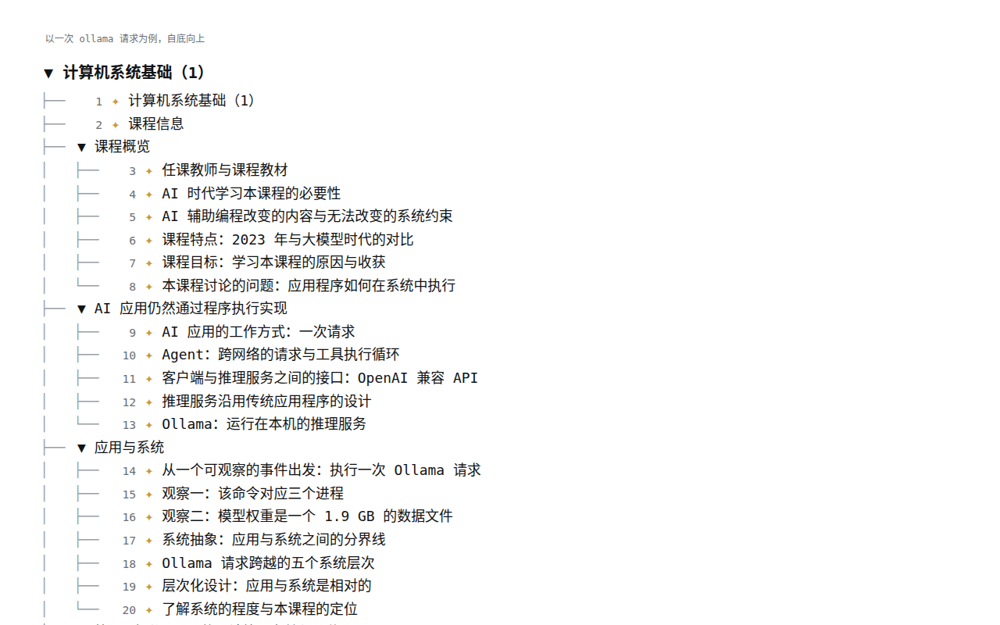 | 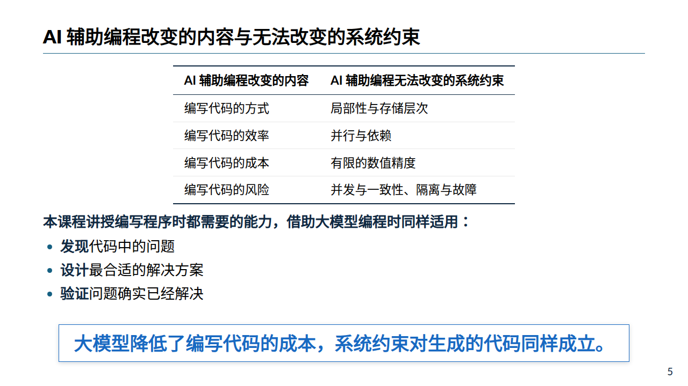 |

## 阅读本教程前要知道的事

**命令行。** 教程里大部分操作在「终端」里完成。终端是一个窗口，你在里面输入一行文字（一条命令），按回车，电脑执行它并把结果打印在下面。每部分开头都会讲你的系统怎样打开终端。

**代码块。** 教程里形如下面这样的灰色方块是命令，整行复制、粘贴进终端、按回车即可。方块里一行是一条命令，多行就逐行执行。

```bash
git --version
```

命令下面标着「输出」的方块是你应当看到的大致结果。版本号和你的用户名会和教程不同，这是正常的。

**粘贴。** Windows 终端里用 Ctrl + V 或鼠标右键粘贴；macOS 终端用 Command + V；Ubuntu 终端用 Ctrl + Shift + V。

**路径。** 命令里的 `lectures/1-intro` 这样的部分是目录名。`cd` 命令用来进入目录，`ls` 命令列出当前目录里的内容。在 Windows 上路径的分隔符是 `\`，但 `/` 同样有效。

**中断。** 一条命令不动了、或者想停止它，按 Ctrl + C。

## 第一部分：Windows

以 Windows 11 为例，Windows 10 的步骤相同。

### 1.1 打开终端

以下任意一种方法都可以。

- 在任务栏的「开始」按钮上点鼠标右键，菜单里选「终端」。Windows 10 上这一项叫「Windows PowerShell」。
- 按键盘上的 Win + R，在弹出的「运行」框里输入 `powershell`，按回车。
- 点「开始」，直接输入 `powershell`，在搜索结果里打开「Windows PowerShell」。

打开后是一个带蓝色或黑色背景的窗口，最后一行类似下面这样，`>` 后面有一个闪动的光标，命令就输入在那里。`C:\Users\` 后面是你的用户名。

```text
PS C:\Users\你的用户名>
```

### 1.2 安装 Git

打开 <https://git-scm.com/download/win>。页面第一段的「Click here to download」和下方「Standalone Installer」下的「Git for Windows/x64 Setup」是同一个文件，点任意一个开始下载。

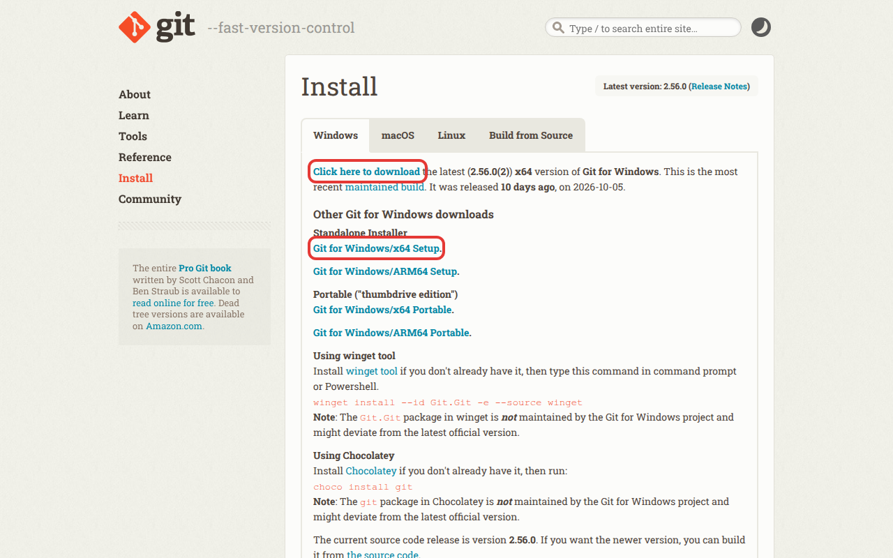

如果你的电脑是 ARM 架构（例如 Surface Pro X 或使用骁龙处理器的笔记本），改点「Git for Windows/ARM64 Setup」。不确定的话用 x64 版本。

下载完成后双击 `Git-2.56.0.2-64-bit.exe`（版本号可能更新）。Windows 问「是否允许此应用对你的设备进行更改」时选「是」。安装向导有十来页选项，**全部保持默认，一路点「Next」，最后点「Install」**。

安装完成后，**关闭已经打开的终端窗口，重新打开一个**（新打开的终端会重新加载环境变量，此时才能找到 Git 可执行程序），输入：

```bash
git --version
```

输出：

```text
git version 2.56.0.windows.2
```

### 1.3 安装 Python

打开 <https://www.python.org/downloads/>。页面上方有一个黄色按钮「Download Python install manager」，**不要点它**，点它下面一行「Or get the standalone installer for」后面的链接「Python 3.15.0」。

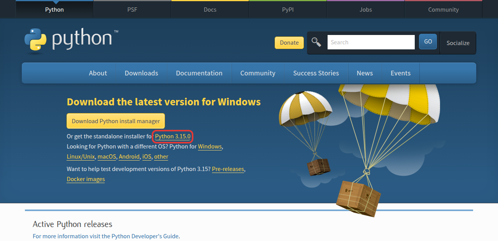

这会下载 `python-3.15.0-amd64.exe`。如果页面布局变了，也可以从任意一个 3.12 以上版本的发布页（例如 <https://www.python.org/downloads/release/python-3150/>）底部的「Files」表格里找「Windows installer (64-bit)」，它标着「Recommended」。

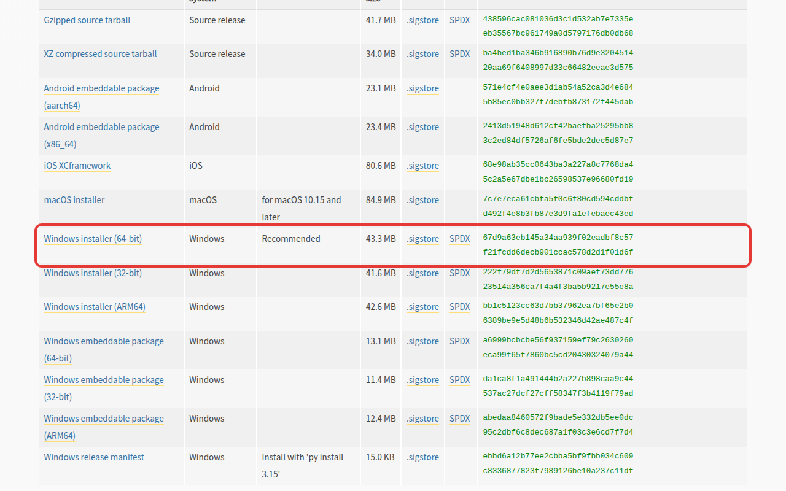

双击下载的文件。安装程序的第一个界面上有两个按钮「Install Now」和「Customize installation」，**界面底部有一个复选框「Add python.exe to PATH」，先勾上它，再点「Install Now」**。这个复选框默认不勾，请不要遗漏它，否则之后在终端里输入 `python` 会提示找不到命令。

安装结束后，重新打开一个终端，输入：

```bash
python --version
```

输出：

```text
Python 3.15.0
```

如果输入 `python` 后弹出了 Microsoft Store，说明没有勾选「Add python.exe to PATH」。请重新运行安装程序，选「Modify」，一路下一步到「Advanced Options」，勾上「Add Python to environment variables」，完成后再开新终端试一次。

课件要求 Python 版本在 3.12 及以上，3.12、3.13、3.14、3.15 都可以。

### 1.4 安装 Node.js

打开 <https://nodejs.org/zh-cn/download>。页面上半部分是给 Docker 用户的命令，往下滚动到「或者获得适用于 Windows x64 平台的 Node.js 构建」，点绿色按钮「Windows 安装程序(.msi)」。版本选择框保持默认的 LTS 版本。

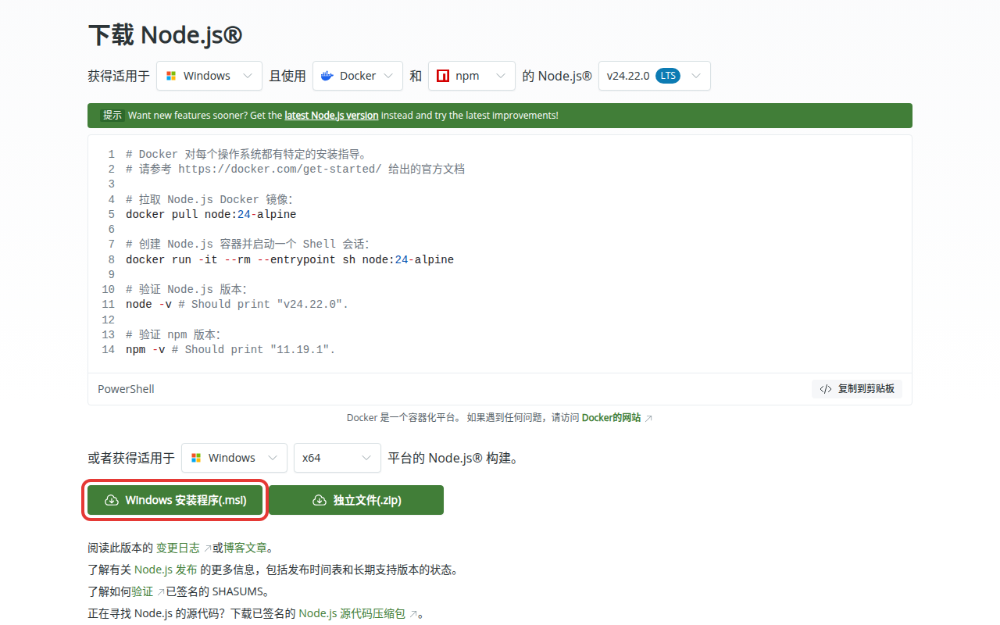

ARM 架构的电脑把「x64」改成「ARM64」再下载。

双击下载的 `node-v24.22.0-x64.msi`，全部保持默认，一路「Next」。其中一页「Tools for Native Modules」有一个复选框「Automatically install the necessary tools」，**不要勾选**，否则会额外安装几 GB 的编译工具，这里用不到。

重新打开一个终端，输入：

```bash
node --version
```

输出：

```text
v24.22.0
```

### 1.5 下载课件

打开 <https://github.com/SJTU-IPADS/OS-Course-Lab>，点右侧绿色的「Code」按钮。

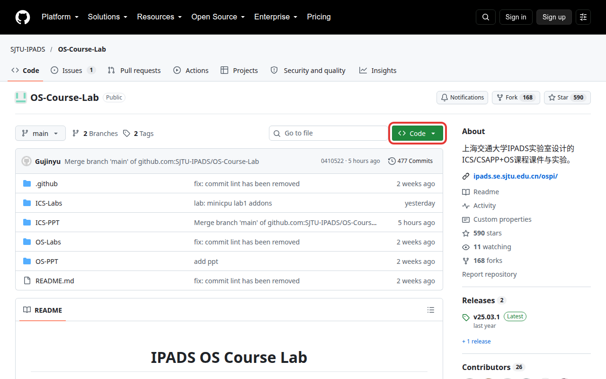

弹出的面板里选「HTTPS」标签，下面的方框里就是仓库地址，点方框右边的复制图标。地址是 `https://github.com/SJTU-IPADS/OS-Course-Lab.git`。

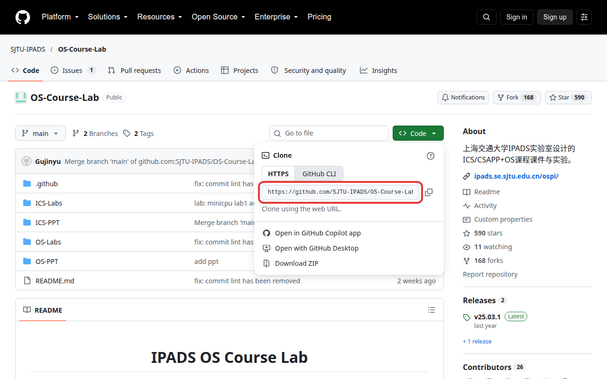

课件放在桌面上。打开终端，它默认位于你的用户目录（`C:\Users\你的用户名`），先用下面的命令进入桌面：

```bash
cd ([Environment]::GetFolderPath("Desktop"))
```

这条命令向 Windows 查询桌面所在的文件夹并进入它。执行后，提示符变成桌面的路径，通常是下面两种之一：

```text
PS C:\Users\你的用户名\Desktop>
PS C:\Users\你的用户名\OneDrive\桌面>
```

出现第二种说明你的桌面由 OneDrive 同步，课件也会随之上传到 OneDrive，占用约 1 GB 云盘空间。开启 OneDrive 同步后，`C:\Users\你的用户名\Desktop` 不再是屏幕上的桌面，所以这里不直接用 `cd Desktop`。

然后输入下面的命令，`git clone` 后面是刚才复制的地址：

```bash
git clone https://github.com/SJTU-IPADS/OS-Course-Lab.git
```

输出：

```text
Cloning into 'OS-Course-Lab'...
remote: Enumerating objects: ...
Receiving objects: 100% (...), done.
Updating files: 100% (9525/9525), done.
```

仓库接近 900 MB，网络慢时需要几分钟，期间百分比会一直变化。下载完成后，桌面上出现一个 `OS-Course-Lab` 文件夹。

网络很慢或中途失败时，可以先删掉未下载完的 `OS-Course-Lab` 文件夹，然后改用下面的命令，它只下载最新版本而不含历史记录，这样体积会小很多：

```bash
git clone --depth 1 https://github.com/SJTU-IPADS/OS-Course-Lab.git
```

课件在仓库的 `ICS-PPT` 子目录。进入这个目录，查看内容：

```bash
cd OS-Course-Lab\ICS-PPT
ls
```

你会看到 `AGENTS.md`、`README.md`、`docs`、`examples`、`lecturekit`、`lectures`、`pyproject.toml`、`scripts`、`tests`、`themes` 等条目。每一讲的课件是 `lectures` 下的一个子目录：

```bash
ls lectures
```

输出（随课程进度增加）：

```text
1-intro
2-data
3-asm
4-cpu
tut-asm-lab
```

### 1.6 安装 lecturekit

仍在 `ICS-PPT` 目录里（终端提示符应以 `OS-Course-Lab\ICS-PPT>` 结尾），运行两条命令。第一条安装 lecturekit 和它依赖的 Python 库：

```bash
python -m pip install -e .
```

输出的最后一行类似：

```text
Successfully installed Pillow-12.3.0 XlsxWriter-3.2.9 ... lecturekit-0.1.0 ...
```

第二条下载把幻灯片编译成网页的工具 Marp，它放在 `ICS-PPT\node_modules` 下，只需运行一次：

```bash
npm install --no-audit --no-fund @marp-team/marp-cli@4.5.0
```

输出的最后一行类似：

```text
added 153 packages in 14s
```

如果第二条命令报红字错误「无法加载文件 npm.ps1，因为在此系统上禁止运行脚本」，这是 PowerShell 的默认安全设置。运行下面这条命令，提示时输入 `Y` 回车，然后重新运行上面的 `npm install`：

```bash
Set-ExecutionPolicy -Scope CurrentUser RemoteSigned
```

这两条命令都要访问境外服务器。下载很慢时，可以改用下面的命令，这样会从国内镜像源进行下载：

```bash
python -m pip install -e . -i https://pypi.tuna.tsinghua.edu.cn/simple
```

```bash
npm install --no-audit --no-fund --registry=https://registry.npmmirror.com @marp-team/marp-cli@4.5.0
```

### 1.7 打开课件

仍在 `ICS-PPT` 目录里：

```bash
python -m lecturekit.cli view lectures/1-intro
```

终端打印几行信息，最后一行是生成的网页路径，随后浏览器自动打开课件的大纲。

```text
[  INFO ] Converting 1 markdown...
[  INFO ] slides.md => slides.html
build\ics-intro-viewer\index.html
```


点大纲里的任意一行就进入那一页。接下来读[第四部分：使用课件](#第四部分使用课件)。

以后每次看课件：打开终端，进入桌面上的课件目录，运行 `view`。

```bash
cd ([Environment]::GetFolderPath("Desktop"))
cd OS-Course-Lab\ICS-PPT
python -m lecturekit.cli view lectures/1-intro
```

## 第二部分：macOS

Intel 和 Apple 芯片的 Mac 步骤相同，下载的安装包都同时支持两种芯片。

### 2.1 打开终端

以下任意一种方法都可以。

- 按 Command + 空格打开「聚焦搜索」，输入「终端」或「Terminal」，回车。
- 打开「启动台」，进入「其他」文件夹，点「终端」。
- 在「访达」里进入「应用程序 / 实用工具」，双击「终端」。

打开后最后一行类似下面这样，`%` 后面是光标：

```text
你的用户名@MacBook-Air ~ %
```

### 2.2 安装 Git

macOS 自带的「命令行开发者工具」里包含 Git。在终端里输入：

```bash
git --version
```

如果已经安装，会直接打印版本号。如果没有，macOS 会弹出一个对话框：「“git”命令需要命令行开发者工具。您要现在安装该工具吗？」点「安装」，再点「同意」，等待下载完成（约 1 GB，需要几分钟到十几分钟）。没有弹出对话框时，运行下面的命令可以主动触发它：

```bash
xcode-select --install
```

这正是 Git 官网 <https://git-scm.com/download/mac> 推荐的方法之一。页面上的 Homebrew 方法也可以，但需要先安装 Homebrew，本教程不用它。

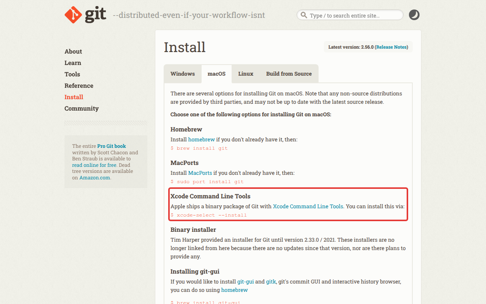

安装完成后再次运行 `git --version`，输出类似：

```text
git version 2.50.1 (Apple Git-155)
```

### 2.3 安装 Python

命令行开发者工具自带的 Python 版本太旧，课件需要 3.12 或更新，所以要从官网安装。打开 <https://www.python.org/downloads/>，点黄色按钮「Download Python 3.15.0」。

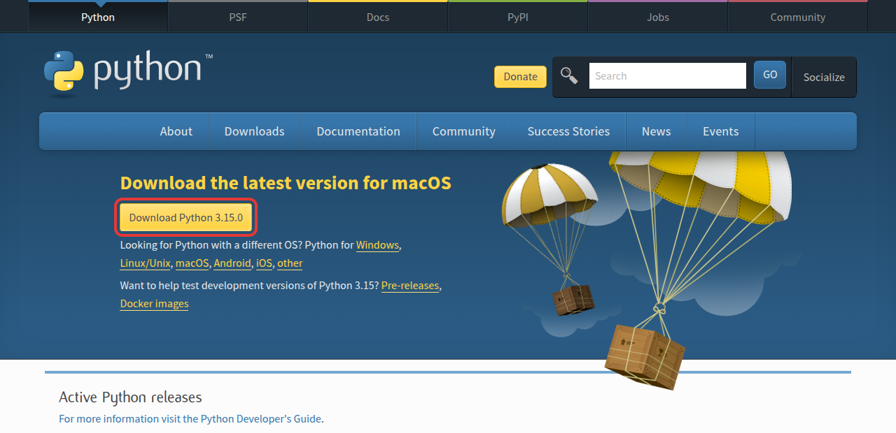

如果页面布局变了，也可以在发布页底部的「Files」表格里找「macOS installer」。

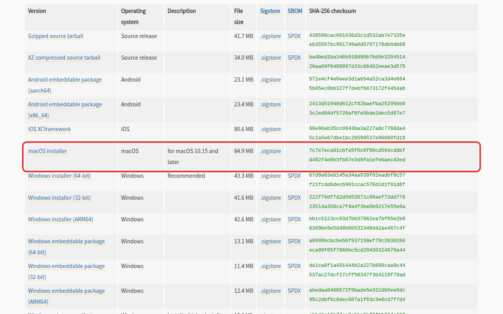

双击下载的 `python-3.15.0-macos11.pkg`，一路「继续」，同意许可，点「安装」，输入你的开机密码。安装完成时会打开一个访达窗口，直接关掉即可。

**关闭终端窗口，重新打开一个**，输入：

```bash
python3 --version
```

输出：

```text
Python 3.15.0
```

如果打印的版本是 3.9 这样的旧版本，说明终端用的还是系统自带的 Python。确认已经关闭并重新打开了终端；仍不对时运行 `echo $PATH`，其中应含有 `/Library/Frameworks/Python.framework/Versions/3.15/bin`，没有的话重新运行一遍安装程序。

### 2.4 安装 Node.js

打开 <https://nodejs.org/zh-cn/download>，往下滚动到「或者获得适用于 macOS ... 平台的 Node.js 构建」，点绿色按钮「macOS 安装程序(.pkg)」。版本选择框保持默认的 LTS 版本，芯片类型页面会自动识别，并且这个安装包本身同时支持两种芯片。

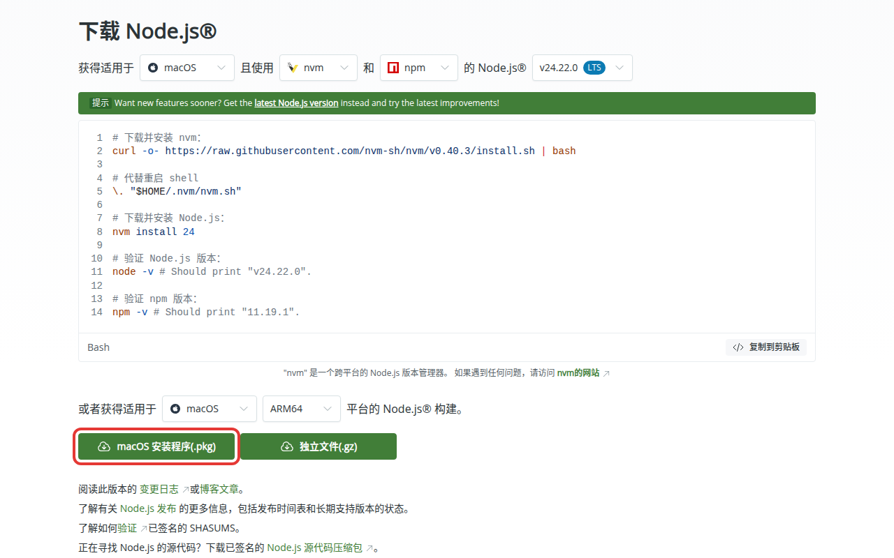

双击下载的 `node-v24.22.0.pkg`，一路「继续」、「安装」，输入开机密码。重新打开终端，输入：

```bash
node --version
```

输出：

```text
v24.22.0
```

### 2.5 下载课件

打开 <https://github.com/SJTU-IPADS/OS-Course-Lab>，点右侧绿色的「Code」按钮。


弹出的面板里选「HTTPS」标签，点地址右边的复制图标。地址是 `https://github.com/SJTU-IPADS/OS-Course-Lab.git`。


课件放在桌面上。在终端里运行下面两条命令，第一条进入桌面，第二条把课件下载到这里：

```bash
cd ~/Desktop
git clone https://github.com/SJTU-IPADS/OS-Course-Lab.git
```

macOS 的桌面文件夹在终端里叫 `Desktop`，在访达里显示为「桌面」，两者是同一个文件夹。第一次在终端里访问桌面时，macOS 会弹出对话框「“终端”想要访问“桌面”文件夹中的文件」，点「好」或「允许」。如果「系统设置 / Apple ID / iCloud / iCloud 云盘」里开启了「桌面与文稿文件夹」，课件也会随之上传到 iCloud，占用约 1 GB 云端空间。

输出：

```text
Cloning into 'OS-Course-Lab'...
remote: Enumerating objects: ...
Receiving objects: 100% (...), done.
Updating files: 100% (9525/9525), done.
```

仓库接近 900 MB，网络慢时需要几分钟。网络很慢或中途失败时，可以先删掉未下载完的 `OS-Course-Lab` 文件夹，改用只下载最新版本的命令：

```bash
git clone --depth 1 https://github.com/SJTU-IPADS/OS-Course-Lab.git
```

课件在仓库的 `ICS-PPT` 子目录：

```bash
cd OS-Course-Lab/ICS-PPT
ls lectures
```

输出（随课程进度增加）：

```text
1-intro		2-data		3-asm		4-cpu		tut-asm-lab
```

### 2.6 安装 lecturekit

仍在 `ICS-PPT` 目录里，运行两条命令。第一条安装 lecturekit 和它依赖的 Python 库：

```bash
python3 -m pip install -e .
```

输出的最后一行类似：

```text
Successfully installed Pillow-12.3.0 XlsxWriter-3.2.9 ... lecturekit-0.1.0 ...
```

第二条下载把幻灯片编译成网页的工具 Marp，只需运行一次：

```bash
scripts/prepare.sh
```

输出的最后两行：

```text
prepare: @marp-team/marp-cli v4.5.0 (w/ @marp-team/marp-core v4.4.0)
prepare: done — render and view now run marp locally, no registry lookup.
```

这两条命令都要访问境外服务器。下载很慢时，第一条换成使用国内镜像的版本，第二条换成直接调用 npm 并指定镜像：

```bash
python3 -m pip install -e . -i https://pypi.tuna.tsinghua.edu.cn/simple
```

```bash
npm install --no-audit --no-fund --registry=https://registry.npmmirror.com @marp-team/marp-cli@4.5.0
```

### 2.7 打开课件

仍在 `ICS-PPT` 目录里：

```bash
python3 -m lecturekit.cli view lectures/1-intro
```

终端打印几行信息，最后一行是生成的网页路径，随后浏览器自动打开课件的大纲。

```text
[  INFO ] Converting 1 markdown...
[  INFO ] slides.md => slides.html
build/ics-intro-viewer/index.html
```


点大纲里的任意一行就进入那一页。接下来读[第四部分：使用课件](#第四部分使用课件)。

以后每次看课件：打开终端，进入桌面上的课件目录，运行 `view`。

```bash
cd ~/Desktop/OS-Course-Lab/ICS-PPT
python3 -m lecturekit.cli view lectures/1-intro
```

## 第三部分：Ubuntu

以 Ubuntu 24.04 LTS 为例，更新的版本步骤相同。Ubuntu 22.04 自带的 Python 是 3.10，低于课件要求的 3.12，建议升级系统到 24.04 或更新。

### 3.1 打开终端

按 Ctrl + Alt + T。或者点左上角「活动」，输入「终端」或「Terminal」，打开它。

打开后最后一行类似下面这样，`$` 后面是光标：

```text
你的用户名@主机名:~$
```

以 `sudo` 开头的命令需要管理员权限，运行时会要求输入你的开机密码。输入密码时屏幕上不会显示任何字符，输完直接回车。

### 3.2 安装 Git、Python 和 Node.js

Ubuntu 的软件都从软件源安装，三个工具一条命令装完。`build-essential` 是 C 编译器，课件里的部分演示要用到：

```bash
sudo apt update
sudo apt install -y git python3 python3-venv python3-pip nodejs npm build-essential
```

安装过程打印很多行，结束后回到提示符。检查版本：

```bash
git --version
python3 --version
node --version
```

输出（24.04 上的版本号；更新的 Ubuntu 会更高）：

```text
git version 2.43.0
Python 3.12.3
v18.19.1
```

### 3.3 下载课件

打开 <https://github.com/SJTU-IPADS/OS-Course-Lab>，点右侧绿色的「Code」按钮。


弹出的面板里选「HTTPS」标签，点地址右边的复制图标。地址是 `https://github.com/SJTU-IPADS/OS-Course-Lab.git`。


课件放在桌面上。在终端里运行下面两条命令，第一条进入桌面，第二条把课件下载到这里：

```bash
cd "$(xdg-user-dir DESKTOP)"
git clone https://github.com/SJTU-IPADS/OS-Course-Lab.git
```

第一条命令向系统查询桌面所在的目录并进入它。中文环境的 Ubuntu 桌面目录是 `~/桌面`，英文环境是 `~/Desktop`，这条命令两种情况都适用，双引号不能省略。

输出：

```text
Cloning into 'OS-Course-Lab'...
remote: Enumerating objects: ...
Receiving objects: 100% (...), done.
Updating files: 100% (9525/9525), done.
```

仓库接近 900 MB，网络慢时需要几分钟。网络很慢或中途失败时，可以先删掉未下载完的目录，改用只下载最新版本的命令：

```bash
git clone --depth 1 https://github.com/SJTU-IPADS/OS-Course-Lab.git
```

课件在仓库的 `ICS-PPT` 子目录：

```bash
cd OS-Course-Lab/ICS-PPT
ls lectures
```

输出（随课程进度增加）：

```text
1-intro  2-data  3-asm  4-cpu  tut-asm-lab
```

### 3.4 安装 lecturekit

Ubuntu 不允许往系统自带的 Python 里直接安装库（直接运行 `pip install` 会报 `externally-managed-environment`），所以先在课件目录里建一个独立的 Python 环境，lecturekit 装在这个环境里。仍在 `ICS-PPT` 目录里：

```bash
python3 -m venv .venv
source .venv/bin/activate
```

第二条命令执行后，提示符最前面多出 `(.venv)`，表示这个环境已经启用：

```text
(.venv) 你的用户名@主机名:~/桌面/OS-Course-Lab/ICS-PPT$
```

**以后每次新开终端，进入课件目录后都要先运行 `source .venv/bin/activate`**，否则下面的命令会报找不到 lecturekit。

接着安装 lecturekit 和它依赖的 Python 库：

```bash
pip install -e .
```

输出的最后一行类似：

```text
Successfully installed Pillow-12.3.0 XlsxWriter-3.2.9 ... lecturekit-0.1.0 ...
```

再下载把幻灯片编译成网页的工具 Marp，只需运行一次：

```bash
scripts/prepare.sh
```

输出的最后两行：

```text
prepare: @marp-team/marp-cli v4.5.0 (w/ @marp-team/marp-core v4.4.0)
prepare: done — render and view now run marp locally, no registry lookup.
```

这两条命令都要访问境外服务器。下载很慢时，第一条换成使用国内镜像的版本，第二条换成直接调用 npm 并指定镜像：

```bash
pip install -e . -i https://pypi.tuna.tsinghua.edu.cn/simple
```

```bash
npm install --no-audit --no-fund --registry=https://registry.npmmirror.com @marp-team/marp-cli@4.5.0
```

### 3.5 打开课件

仍在 `ICS-PPT` 目录里，提示符前带着 `(.venv)`：

```bash
python3 -m lecturekit.cli view lectures/1-intro
```

终端打印几行信息，最后一行是生成的网页路径，随后浏览器自动打开课件的大纲。

```text
[  INFO ] Converting 1 markdown...
[  INFO ] slides.md => slides.html
build/ics-intro-viewer/index.html
```


点大纲里的任意一行就进入那一页。接下来读[第四部分：使用课件](#第四部分使用课件)。

以后每次看课件：打开终端，进入桌面上的课件目录，启用环境，运行 `view`。

```bash
cd "$(xdg-user-dir DESKTOP)/OS-Course-Lab/ICS-PPT"
source .venv/bin/activate
python3 -m lecturekit.cli view lectures/1-intro
```

在 Windows 的 WSL2 里使用 Ubuntu 时，浏览器可能不会自动弹出。这时改用 [4.3 节](#43-在课件里运行演示)的 `--watch` 方式，在 Windows 的浏览器里打开 <http://localhost:3030>。

## 第四部分：使用课件

本部分的命令三种系统通用。Windows 上把命令开头的 `python3` 换成 `python`，Ubuntu 上先运行 `source .venv/bin/activate`。所有命令都在 `ICS-PPT` 目录里运行。

### 4.1 翻页与大纲

`view` 打开的第一个页面是大纲：一棵章节树，每行前面的数字是那一页在整个幻灯片里的页码。点任意一行进入那一页。

进入幻灯片后：

| 操作 | 按键或点击 |
| --- | --- |
| 下一页 / 上一页 | → / ←，或空格 / Shift + 空格 |
| 全屏 | f（再按一次退出） |
| 回到大纲 | 页面右上角的「≡ 大纲」按钮 |
| 演讲者视图（显示讲稿和下一页） | p，会打开一个新窗口 |

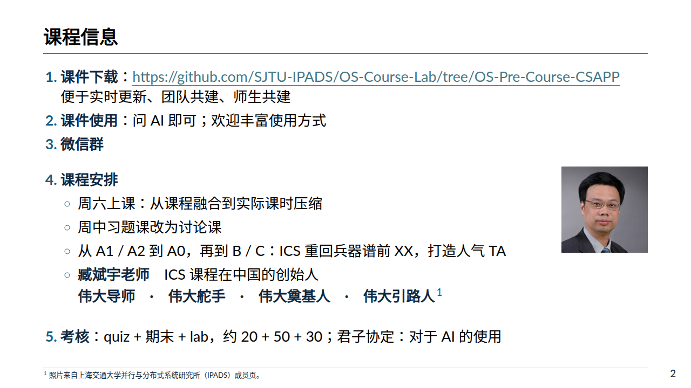

### 4.2 打开其他讲

`lectures` 目录下每个子目录是一讲，把 `view` 后面的目录换掉即可：

```bash
python3 -m lecturekit.cli view lectures/2-data
python3 -m lecturekit.cli view lectures/3-asm
```

`ls lectures` 列出当前有哪些讲。

### 4.3 在课件里运行演示

课件里带 ▶ 按钮的方块是一条真实的命令，幻灯片上印着的是某次运行记录下的输出。想在自己电脑上运行，要用「实时模式」打开课件：

```bash
python3 -m lecturekit.cli view lectures/1-intro --watch
```

这次终端不会退出，而是停在那里充当服务器，浏览器打开的是 <http://localhost:3030>。进入带 ▶ 的页面，点 ▶，命令就在你的电脑上运行，输出实时显示在页面底部弹出的黑色面板里。面板右上角显示命令的退出状态和用时，标签上的 ✕ 关闭这次运行，看完点页面或按 ▾ 收起面板。

| 点 ▶ 之前 | 点 ▶ 之后 |
| --- | --- |
| 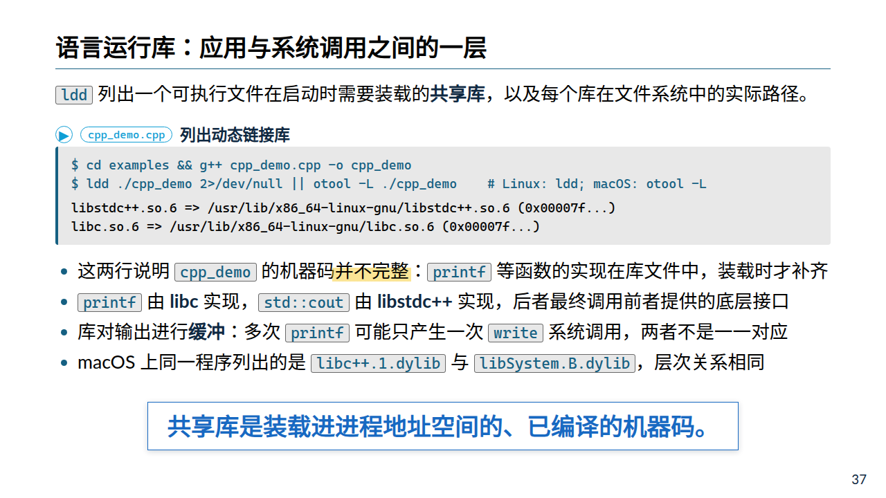 | 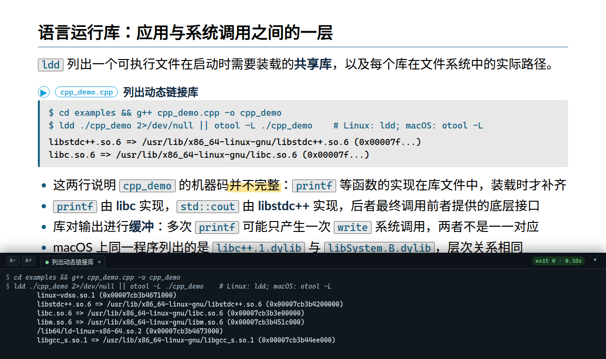 |

演示方块旁边的文件名按钮（例如 `cpp_demo.cpp`）会在页面右侧打开那个源文件。

看完后回到终端，按 Ctrl + C 结束实时模式。

有些演示依赖额外的程序（例如 C 编译器、`ollama`），没有安装时面板会报找不到命令，这不影响看课件——幻灯片上已经印着输出。Windows 上这些命令通过随 Git 一起安装的 Git Bash 运行，所以装了 Git 就能用。

### 4.4 导出 PowerPoint 或 PDF

导出可编辑的 PowerPoint，不需要浏览器：

```bash
python3 -m lecturekit.cli render lectures/1-intro --to pptx
```

文件在桌面的 `OS-Course-Lab/ICS-PPT/build/ics-intro-pptx/计算机系统基础-1.pptx`（目录名和文件名按那一讲的标题生成，终端会打印路径）。导出的幻灯片是真实的文本框和图片，可以在 PowerPoint 或 WPS 里编辑。

导出 PDF 需要电脑上装有 Google Chrome 浏览器：

```bash
python3 -m lecturekit.cli render lectures/1-intro --pdf
```

文件在桌面的 `OS-Course-Lab/ICS-PPT/build/ics-intro-viewer/计算机系统基础-1.pdf`，第一页是可点击的大纲。

### 4.5 更新课件

老师修改课件后，在仓库的任何目录里运行一条命令就能同步：

```bash
git pull
```

输出以 `Already up to date.` 结尾表示没有新内容，否则会列出更新的文件。之后照常运行 `view`。

如果 `git pull` 报错说本地有修改（`Your local changes to the following files would be overwritten`），说明你改动过课件目录里的文件。不需要保留改动时，先丢弃它们再更新：

```bash
git restore .
git pull
```

lecturekit 本身很少变动。当 `view` 在更新后报错时，重新运行一次 1.6 / 2.6 / 3.4 节的两条安装命令即可。

### 4.6 英文版

每一讲带有英文翻译，加 `--lang en` 即可：

```bash
python3 -m lecturekit.cli view lectures/1-intro --lang en
```

## 常见问题

**输入命令后提示「不是内部或外部命令」、「command not found」或「无法将“xxx”项识别为 cmdlet」。** 对应的工具没有装好，或者装好后没有重新打开终端。先关闭所有终端窗口再开一个新的。如果仍然不行，请回到对应的安装小节重新安装，Windows 上注意勾选「Add python.exe to PATH」。

**Windows 上输入 `python` 弹出 Microsoft Store。** 见 1.3 节末尾。

**Windows 上运行 `npm` 报「禁止运行脚本」。** 见 1.6 节，运行 `Set-ExecutionPolicy -Scope CurrentUser RemoteSigned`。

**`pip install` 报 `externally-managed-environment`。** 你在 Ubuntu（或 macOS 的 Homebrew Python）上直接往系统 Python 里装库。按 3.4 节先建立并启用 `.venv` 环境。

**运行 `view` 报 `No module named lecturekit`。** 两种原因：没有在 `ICS-PPT` 目录里，或者 Ubuntu 上没有运行 `source .venv/bin/activate`。

**`git clone` 很慢或中途断开。** 换用 `--depth 1` 的命令，或换一个网络再试。已经下载了一半的 `OS-Course-Lab` 目录（如果存在）要先删掉。

**浏览器没有自动打开。** 终端最后打印的那一行是网页路径（例如 `build/ics-intro-viewer/index.html`）。打开桌面上的 `OS-Course-Lab` 文件夹，依次进入 `ICS-PPT`、`build`、`ics-intro-viewer`，双击 `index.html`。

**`view` 一直停在「Converting 1 markdown...」不动，或者打开的是旧内容。** Marp 没有装好，`view` 退回到每次联网下载的方式。按 Ctrl + C 停掉，重新运行 1.6 / 2.6 / 3.4 节的第二条安装命令（`npm install ...` 或 `scripts/prepare.sh`）。

**导出 PDF 报找不到 Chrome。** 安装 Google Chrome。只有 Edge 时，把环境变量 `CHROME_PATH` 设为 Edge 的路径（通常是 `C:\Program Files (x86)\Microsoft\Edge\Application\msedge.exe`）再运行；Chrome 已装但仍报错时，同样把 `CHROME_PATH` 设为它的路径。

**想删掉重来。** 删除桌面上的整个 `OS-Course-Lab` 文件夹，从「下载课件」一节重新开始。
